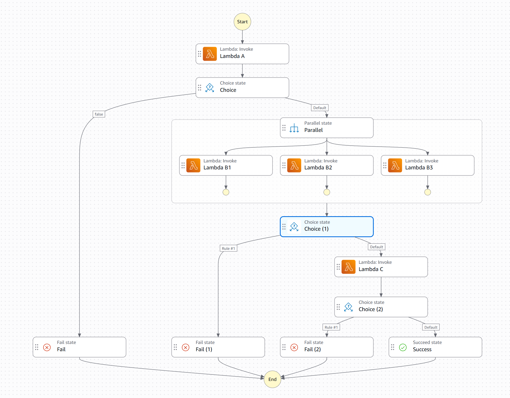

# Phase 2 Stretch Goal: Step Functions Alternative

This is a design-only alternative for the Phase 2 stretch goal. It is not
implemented in the current CDK application. The current DynamoDB Streams,
Orchestrator Lambda, and Worker Lambda design remains unchanged.

## Proposed architecture

Use an AWS Step Functions **Standard** state machine to coordinate task
execution. Keep the existing task Lambdas, workflow table, API read paths, and
dashboard. API Gateway continues to invoke the existing API Lambda. That API
Lambda creates the workflow and task records, then calls Step Functions
`StartExecution`. `StartExecution` starts the state machine; it is not itself a
state inside the workflow. The first state in the workflow invokes the existing
ValidationFunction (Task A). Step Functions invokes each task Lambda directly
and updates the table as tasks transition.

The following Workflow Studio diagram illustrates the proposed visual flow.
It is a design reference, not a deployed or executable state machine.

The API Gateway and API Lambda are outside the state machine. In the console,
`StartExecution` describes the API Lambda's call that starts the execution; it
should not be drawn as a workflow state before Task A. The first Lambda Invoke
state inside the state machine should select the existing **ValidationFunction**
from `PayloadStack` (Task A), not the API, Orchestrator, or Worker Lambda.

## State-machine steps

1. **Start execution.** The API Lambda creates the META record and five
   `PENDING` task records, then calls `StartExecution` with the `workflowId`
   and release input. Store the execution ARN on the META record if useful for
   status and support. Define an idempotency/recovery strategy for the case
   where record creation succeeds but `StartExecution` fails.
2. **Run validation task A.** Conditionally change A from `PENDING` to
   `RUNNING`, then invoke the existing `ValidationFunction`. Pass its expected
   release input (`version`, `environment`, and `approved`); keep the
   `workflowId` available to status-update states. Persist its result. A
   failure or caught invocation error marks A `FAILED`, marks dependent tasks
   `SKIPPED`, and finishes the workflow as `FAILED`.
3. **Run B1, B2, and B3 in parallel.** After A succeeds, use a `Parallel`
   state with one branch per existing task Lambda: `BuildVerificationFunction`,
   `ArtifactVerificationFunction`, and `SecurityScanFunction`. Each branch
   marks its task `RUNNING`, invokes the Lambda, maps its result to the
   existing status model, and persists the result. `WARNING` maps to
   `COMPLETED_WITH_WARNINGS` and does not block C.
4. **Join and decide about C.** Each branch should return a result describing
   its terminal status. A task's returned `FAILURE` is a normal Lambda
   response, not a Step Functions invocation error, so the branch must inspect
   the `outcome`. Use `Catch` separately for invocation errors, persist those
   as task failures, and return a failure result so the other branches can
   finish. Do not send an individual branch to a `Fail` state before the join:
   that would fail the whole `Parallel` state and bypass the normal join
   decision. After the join, proceed to C only if no branch failed. Otherwise
   mark C `SKIPPED` and the workflow `FAILED`.
5. **Run C and finalize.** If the branches are successful or warnings,
   conditionally mark C `RUNNING`, invoke the existing
   `ReleaseCompletionFunction`, and persist its terminal result. Set the META
   item to `FAILED` if any task failed; otherwise
   `COMPLETED_WITH_WARNINGS` if any task warned; otherwise `COMPLETED`.
   Preserve the same conditional state transitions and timestamps used by the
   current design.
6. **Handle retries and execution errors.** Add retry policies for appropriate
   transient errors and top-level `Catch` paths that persist workflow failure
   if an unexpected state-machine error escapes task-level handling. Make
   status updates idempotent and define how stopped executions are reconciled
   and retried.

The state machine can update DynamoDB using scoped Step Functions AWS SDK
integrations, or a small dedicated status-update function if that makes result
handling clearer. In either case, task business rules stay in the task
Lambdas. The API keeps reading the same DynamoDB status model, so the dashboard
does not need to know which orchestration engine ran the workflow.

## What changes from the current design

- Remove the Orchestrator and Worker Lambdas.
- Replace stream-triggered coordination with an API-triggered state-machine
  execution.
- Remove the DynamoDB Stream and its event-source mapping if no other consumer
  needs it.
- Give the state machine permission to invoke only the five task Lambdas and
  update only the workflow table. Give the API Lambda permission to start only
  this state machine.
- Keep DynamoDB as the dashboard/API status store; Step Functions execution
  history supplements it rather than replacing those read paths.

## Benefits and tradeoffs

**Benefits**

- The workflow graph, parallel branches, and task progress are visible in
  Step Functions execution history.
- Retries, catches, timeouts, and parallel coordination are expressed in the
  state machine instead of custom orchestration code.
- Eliminating the Worker removes its task-claiming, invocation, and outcome
  mapping code; eliminating the Orchestrator removes stream-driven scheduling
  and re-drive logic.

**Tradeoffs**

- This adds a managed service, state-machine definition, IAM role, and
  Step Functions charges. Standard workflows are a good fit for durable,
  inspectable executions, but each state transition is billable.
- The state machine must faithfully implement the existing warning, failure,
  and skip rules. A Lambda invocation that returns `FAILURE` is still a
  successful service invocation, so the state machine must inspect the
  returned outcome; `Catch` handles invocation errors, not business outcomes.
- DynamoDB remains necessary for the existing API and dashboard. Its writes
  must stay consistent with execution progress, and duplicate start requests
  and interrupted executions need an explicit recovery policy.
- Some orchestration logic moves into ASL (Amazon States Language) rather than
  disappearing. Complex state-machine definitions can be harder to maintain
  than code for highly dynamic workflows.

This design is most attractive when execution visibility, built-in workflow
control, and reduced custom orchestration code are more valuable than keeping
the service count and architecture minimal.
